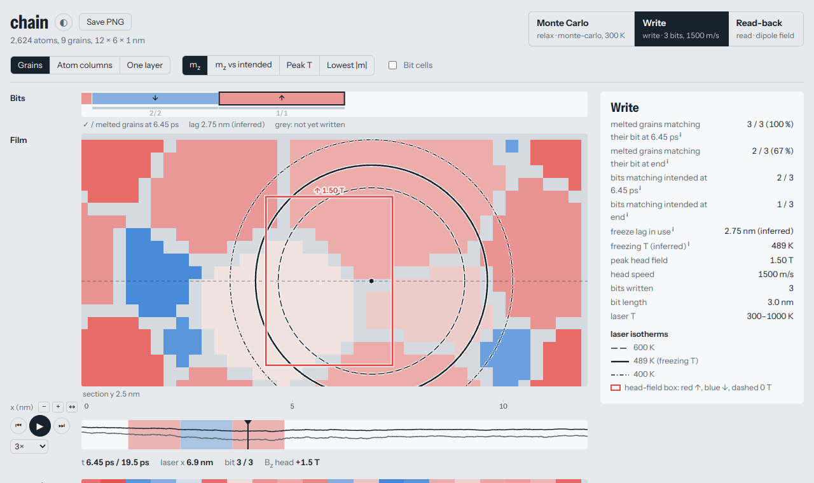

# hamrvis

**See what happened in your VAMPIRE heat-assisted magnetic recording (HAMR) simulations.**

[VAMPIRE](https://vampire.york.ac.uk/) writes gigabytes of numbers. hamrvis turns a folder of finished runs into an
interactive page in your browser: watch the laser cross the film, see which grains froze with which magnetisation,
and check whether each bit was written as intended.



*A write on the small example film included in this repository, part way through. Grains are coloured by
magnetisation: red up, blue down.*

## Try it in a minute

You need Python 3.8 or newer. No VAMPIRE run is needed: the repository includes small example runs.

```bash
git clone https://github.com/RandmC13/hamrvis.git
cd hamrvis
pip install .

hamrvis reduce tests/scenarios/chain -o my-first-bundle
hamrvis view my-first-bundle
```

Your browser opens at <http://127.0.0.1:8737/>. There is one tab per run, here a Monte Carlo relaxation, a write and
a read-back. Open **Write**, press play, and hover over a grain to see its history. Press Ctrl+C in the terminal to
stop the viewer.

Nothing leaves your computer: the viewer runs locally. The page does load its font from Google Fonts, and falls back
to a system font when offline.

## How it works

There are two steps, because simulation data is usually too large to move around:

1. **`hamrvis reduce`** condenses your runs into a *bundle*, a folder of averaged data. Run it where the data is, for
   example on your cluster. In one 8.7-million-atom write, 90 GB of spin snapshots became about 2.2 GB.
2. **`hamrvis view`** shows a bundle in your browser. Run it wherever is convenient, for example on your own
   computer.

Bundles hold averages rounded to a stated precision, so keep your VAMPIRE output if you may need the exact values.
The [user guide](docs/user-guide.md#how-much-is-kept) says what is kept.

## Use it on your own runs

**1. Ask VAMPIRE for the data.** Add these lines to the input file of your runs before running them:

```
output:column-headers
output:real-time
output:magnetisation
grain:real-time
grain:magnetisation
grain:output-rate = 1000
create:grain-shape-output
config:atoms
config:atoms-output-rate = 5000
config:output-format = binary
```

For a read-back run, also add `dipole:output-dipole-field`. The two rates are examples: lower values give finer time
resolution and use more disk.

**2. Check what hamrvis can find.** Point it at one run folder, or at a folder holding several:

```bash
hamrvis inspect my-runs/
```

This lists each run, which views it can show, which input line would add a missing view, and the estimated bundle
size. It reads only small files, so it is quick and safe to run at any time.

**3. Reduce and view.**

```bash
hamrvis reduce my-runs/ -o my-bundle
hamrvis view my-bundle
```

### On a cluster

Reduce on the cluster, then copy only the bundle home. The included script is a starting point for Slurm; run it from
a clone of this repository:

```bash
sbatch --account=<project> scripts/slurm-reduce.job my-runs/ ~/scratch/bundles/my-bundle
```

If your cluster needs a module for Python and numpy, set it with `PY_MODULE=<module>` when you submit. If the job
runs out of time, submit the same command again and it carries on from where it stopped.

Then, on your own computer:

```bash
rsync -av <cluster>:scratch/bundles/my-bundle ~/hamr-bundles/
hamrvis view ~/hamr-bundles/my-bundle
```

### Share a run

`export` writes one HTML file that anyone can open without installing anything:

```bash
hamrvis export my-bundle -o my-run.html
```

It keeps every 4th grain frame by default and stops if the page goes over 15.5 MB. See the
[user guide](docs/user-guide.md#commands) for how to change these. Bundles and exported pages record the full paths of
your run folders, so check Run details before sharing.

## What you can see

| Tab | Shown for | Views |
|---|---|---|
| **Write** | `sim:program = hamr-simulation` | Bits, film, laser and field overlays, space–time diagram, per-grain life stories, write analysis |
| **Monte Carlo** | Monte Carlo integrators | Grain and atom views, against Monte Carlo steps |
| **Read-back** | Dipole field output | Stray-field map, field section, read-back waveform |
| Other | Any other VAMPIRE run | Whatever it wrote: grain and atom views, time line, run details |

Each view appears only if the run wrote the data it needs.

## How far to trust the numbers

hamrvis separates what VAMPIRE recorded from what it works out itself:

- Magnetisation and grain values come from VAMPIRE's files, rounded to the stated precision. Each reduce checks the
  stored values against the exact means and against `grain.txt`, and shows the result under Run details.
- The head position, laser temperature and field are rebuilt from your input using VAMPIRE's formulas, and checked
  against VAMPIRE's `B_applied` column and logged head positions when you reduce.
- The write analysis is hamrvis's own interpretation, including the freezing temperature, the freeze lag and which
  grains count as written correctly. [docs/analysis.md](docs/analysis.md) gives the definitions.

## Documentation

- [User guide](docs/user-guide.md): every command and option, what each view shows, and troubleshooting
- [How the write analysis works](docs/analysis.md)
- [Bundle format](docs/bundle-format.md)
- [Design decisions](docs/decisions.md)
- [Changelog](CHANGELOG.md)

If something goes wrong, run `hamrvis inspect` and include its output when you report the problem.

To run the tests: `python3 -m unittest discover tests`.

## Licence and citation

hamrvis is released under the [BSD 2-Clause licence](LICENSE). If you use it in your work, please cite it as described
in [CITATION.cff](CITATION.cff).
